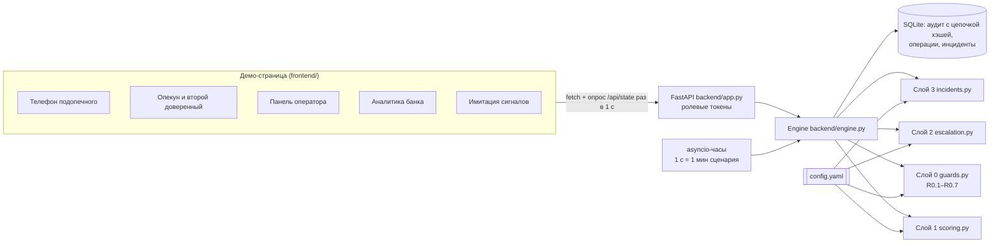

# Қорған — семейная защита операций

Прототип для ITU Hackathon-2026, кейс Банка ЦентрКредит «Инновации в банкинге и кибербезопасность».

Мошенники звонят пожилому человеку и заставляют его самого перевести деньги или оформить кредит. Для банка это решение клиента, поэтому обычный антифрод часто молчит. «Қорған» («крепость») замечает опасную операцию, ставит её на паузу и просит подтверждения у близких. Если доверенные лица молчат, помощник банка опрашивает клиента и подтверждает обычную покупку сам; сотрудника банка клиент зовёт, если захочет. Если никто не решил, операция отменяется и деньги остаются у клиента. Подтвердить операцию сам клиент не может. Отдельно работает кредитный замок. Модуль «Первые 60 минут» после обмана — фаза 2.

-2f8f5f) — общий файл `tests/vectors/vectors.json` проверяют оба движка: `python -m pytest tests/test_vectors.py` и `node standalone/engine.test.js`.

> Всё, что имитирует внешний мир (звонок, удалённый доступ, Антифрод-центр, другие банки, полиция), помечено в интерфейсе как эмуляция. Все цифры приложения синтетические.

## Быстрый старт

```bash
pip install -r requirements.txt
python run.py            # http://127.0.0.1:8000
python -m pytest -q      # 77 тестов: юнит, e2e на 7 сценариев, 21 общий тест-вектор
node standalone/engine.test.js   # тесты JS-движка и те же векторы
node standalone/simulate.js      # прогон синтетического потока → docs/synthetic-run.md
```

Нужен Python 3.11+. Токены ролей задаются в окружении (см. `.env.example`); без них используются демо-значения `demo-<роль>`.

## Демо без сервера

Файл `standalone/korgan.html` открывается двойным щелчком (нужен только браузер). В нём тот же набор правил, что в `backend/`, перенесённый на JavaScript, и новый интерфейс в структуре банковского приложения: серая шапка, чёрная скруглённая панель, зелёная плашка над таб-баром, вкладки Главная, Переводы, Платежи, История, Сервисы. Защита встроена в приложение: раздел «Сервисы → Защита от мошенников», плашка со статусом, кнопка «Меня обманули» и «Связь с банком».

Править удобнее в `standalone/parts/` (`head.html` стили, `body.html` разметка, `engine.js` правила, `ui.js` экран), затем `python standalone/build.py` пересобирает `korgan.html`. Версия на Python остаётся основной (тесты, SQLite, API); JS-версия нужна для показа и проверки в браузере.

## Публикация на GitHub Pages

Демо — один статический файл, сервер не нужен. В корне лежит `index.html` (копия `standalone/korgan.html`, её пишет `python standalone/build.py`) и пустой `.nojekyll`.

1. Загрузите содержимое репозитория на GitHub (публичный репозиторий).
2. Settings → Pages → Source: **Deploy from a branch**, Branch: **main**, папка **/ (root)** → Save.
3. Через 1–2 минуты сайт откроется по адресу `https://<логин>.github.io/<репозиторий>/`.

Бэкенд на Python (`run.py`) на Pages не работает и для демо не нужен: та же логика встроена в страницу.

## Что вошло в сдачу

| Приоритет | Пункт | Статус |
|---|---|---|
| Must | Скоринг с `config.yaml` и тестами | готово |
| Must | Слой 0: R0.1–R0.7 | готово |
| Must | Лестница эскалации и правила решений | готово |
| Must | Сценарии 1–3, экраны подопечного, опекунов, оператора | готово |
| Must | Согласие, аудит с цепочкой хэшей, README и docs | готово |
| Should | Сценарии 4 и 5, кредитный замок, охлаждение при отключении, панель банка | готово |
| Could | Сценарии 6 и 7 («Первые 60 минут», «Спорный товар») | готово в упрощённом виде |
| Could | Казахский интерфейс | отложено |
| Could | Telegram-бот | отложено |

## Архитектура



Время в движке — «минуты сценария». Фоновый asyncio-таск двигает часы (параметр `clock.seconds_per_minute`), тесты двигают их вручную.

## Четыре слоя защиты

**Слой 0. Жёсткие предохранители** (`backend/guards.py`), работают до скоринга:

| Правило | Что делает | Код |
|---|---|---|
| R0.1 | Любой идущий звонок блокирует перевод и кредит | `CALL_ACTIVE` |
| R0.2 | Звонок, завершённый менее 10 мин назад, учитывается в скоринге как звонок | — |
| R0.3 | Удалённый доступ блокирует деньги, кредиты и снятие защиты | `REMOTE_ACCESS` |
| R0.4 | Кредитный замок блокирует кредиты и рассрочки независимо от скоринга | `CREDIT_LOCK` |
| R0.5 | Сбой скоринга → жёлтая зона и событие `scoring_failed` | — |
| R0.6 | Отключение защиты или замка — через 24 ч охлаждения; запрещено во время звонка, при удалённом доступе, на новом устройстве; опекуны уведомлены; подопечный может отменить | `NEW_DEVICE` и др. |
| R0.7 | Удержание не дольше 5 рабочих дней; по истечении операция не проводится, деньги у клиента | статус `EXPIRED` |

**Слой 1. Скоринг 0–100** (`backend/scoring.py`, числа в `config.yaml`):

| Сигнал | Баллы |
|---|---|
| Новый получатель | +25 |
| Получатель в базе подозрительных счетов (имитация) | +30 |
| Сумма ≥ 5× обычной (обычная 40 000 ₸) | +25 |
| Крупная сумма ≥ 100 000 ₸, но < 5× (не суммируется с предыдущим) | +10 |
| Звонок с незнакомого номера (идёт или в окне R0.2) | +35 |
| Звонок знакомого | +5 |
| Ночь | +15 |
| Новое устройство | +10 |
| Белый список | −30 |
| Режим «крупная покупка» | −20 |

Зоны: < 30 зелёная, 30–69 жёлтая, ≥ 70 красная. Итог ограничен 0–100, каждый результат несёт причины человеческим языком.

**Слой 2. Лестница** (`backend/escalation.py`):

| Минута | Шаг |
|---|---|
| 0 | Запрос опекуну |
| 5 | Второму доверенному |
| 15 | Средняя зона: помощник банка задаёт 4 вопроса и подтверждает обычную операцию сам; сотрудник — по просьбе клиента. Красная зона: сотрудник банка |
| 60 | Никто не решил: операция отменяется, деньги у клиента |

Самоподтверждения нет: мошенник, который стоит рядом, продиктует «никто не звонил». Если доверенные лица молчат 15 минут, помощник банка задаёт клиенту 4 вопроса и сам подтверждает обычную покупку или перевод знакомому до 500 000 ₸, если ответы чистые и нет опасных сигналов (звонок с незнакомого номера, подозрительный получатель, недавние коды, кредит наличными, новое устройство). В остальных случаях сотрудника банка клиент зовёт сам кнопкой. Красная зона по-прежнему требует сотрудника банка. Это сознательный компромисс против решения присяжных (они предлагали всегда звать сотрудника): звать сотрудника ради каждой покупки дорого и неудобно, а опасные сигналы помощник сам не пропускает.

Любое «Отклонить» останавливает сразу. В жёлтой зоне достаточно одного «Разрешить». В красной одобрение опекуна сразу отправляет запрос второму; нужен его «Разрешить» или решение оператора (оператор подключается через 5 минут молчания второго). Не больше 5 попыток решения на участника.

**Слой 3. «Первые 60 минут»** (`backend/incidents.py`): опрос из трёх вопросов → автозащита (блок исходящих и карт, сброс сессий, кредитный замок) → карточка инцидента с приоритетом → ветка «Спорный товар» без заморозки (`DISPUTE_CIVIL`) или машина состояний `NEW → TRIAGED → FREEZE_REQUESTED → HELD → RETURNED / RELEASED / EXPIRED → CLOSED`. Продление удержания только с номером заявления в полицию и не дольше R0.7. Получатель уведомляется и может дать пояснения. Граф цепочки переводов, текст заявления в полицию, предупреждение «не платите за возврат денег».

## Демо: лимит → пауза → действие

Демо открывается на сценарии «1. Лимит → пауза». Исходное состояние: защита включена, доверенное лицо — внук Алибек, дневной лимит 100 000 ₸, месячный 400 000 ₸, сегодня уже переведено 40 000 ₸, за месяц 120 000 ₸.

1. «Переводы» → Марат Т. → 70 000 ₸ → «Перевести». Экран «Перевод на паузе» с суммами и тремя действиями. 60 000 ₸ проходит обычным путём (ровно лимит).
2. «Запросить подтверждение» → в колонке «Приложение доверенного лица» (на узком экране — ниже телефона клиента) нажать «Подтвердить перевод» или «Отклонить перевод». После подтверждения клиент видит чек, расходы: 110 000 ₸ за день, 190 000 ₸ за месяц.
3. «Меня просят перевести деньги» (в том числе после запроса): перевод остановлен, создаётся обращение, прежний запрос закрыт.
4. «История» → перевод Самату 40 000 ₸ → чек → «Меня обманули» → «Сообщить банку». Повторное нажатие открывает то же обращение. Работает и без защиты (сценарий «4. Меня обманули»).

После любого обращения включается режим безопасности: кредит наличными закрыт, переводы работают, но перед переводом новому получателю приложение предупреждает о повторных звонках мошенников («вернём деньги, переведите комиссию»). Снимает режим только сотрудник банка. В карточке обращения — «Выйти на всех других устройствах» (текущий телефон остаётся) и «Сменить код входа»; доверенное лицо получает уведомление.

Восстановить исходные данные: нажать чип «1. Лимит → пауза». Демо сохраняется в браузере между перезагрузками и открывается там, где его закрыли.

## Лимиты и частые платежи

- Клиент сам включает лимиты: в сутки и в месяц. Сверх лимита перевод встаёт на паузу: клиент сам запрашивает подтверждение доверенного лица, сообщает о давлении или отменяет перевод. Считаются только выполненные переводы, ровно лимит — без паузы. Понизить можно сразу, повысить — через период охлаждения с уведомлением близких. Переводы по белому списку лимиты не трогают.
- Частые платежи (продукты, коммуналка, внуку, аптека, связь) — крупные кнопки на главной и в «Платежах»: получатель и привычная сумма в одно нажатие, есть «Другая сумма». После перевода его можно сохранить как частый. Частый платёж проверяется так же, как обычный перевод.

## Защита от недобросовестного доверенного

- Отказ доверенного не окончательный: «Не согласен с решением» → решает сотрудник банка после звонка клиенту. Во время звонка обжаловать нельзя.
- Клиент видит каждое действие доверенных («Сервисы → Защита → Что делали доверенные»).
- «Жалоба» на доверенного уходит сотруднику; после проверки личности клиента доверенный удаляется сразу, без охлаждения. Если доверенных не осталось, опасные операции сразу решает сотрудник.
- Больше 3 отказов одного доверенного за неделю — автоматическая проверка.
- Доверенный видит только сумму, имя получателя без номера счёта и причину паузы, которая касается клиента; сведения банка о получателе ему не показываются.

## Сценарии

Выбираются чипами вверху страницы, форма заполняется сама. Для показа жюри — три главных (2, 5, 6), остальные под «Ещё сценарии». Переключатель «Ускоренное время» (1 с = 1 мин, 1 с = 5 мин, пауза) подписан на экране.

1. **Коммуналка** 3 500 ₸ на белый список: балл 0, проходит сразу.
2. **Звонок мошенника.** Перевод 480 000 ₸ во время звонка → `CALL_ACTIVE`. В имитации выбрать «Звонка нет» (положил трубку) и повторить: 25+30+25+35 = 115 → 100, красная зона, опекун отклоняет.
3. **Реальная покупка** 480 000 ₸, режим «крупная покупка»: балл 30, жёлтая. Близкие заняты, на 15-й минуте помощник задаёт вопросы, решает сотрудник банка.
4. **Опекун отклоняет без причины**: 120 000 ₸ мастеру, опекун отклоняет → «Не согласен с решением» → решает сотрудник; жалоба и удаление доверенного через банк.
5. **Кредитный замок**: рассрочка 300 000 ₸ → `CREDIT_LOCK`. Запрос на снятие замка: охлаждение, опекуны уведомлены, замок продолжает действовать.
6. **Первые 60 минут**: 20 минут назад ушло 480 000 ₸ (защита не была подключена). «Меня обманули» → автозащита → оператор удерживает средства в BCC → лента статусов у клиента, время до заморозки у банка.
7. **Спорный товар**: 85 000 ₸ продавцу с историей 4 года, «товар получил» → `DISPUTE_CIVIL`, заморозки нет, честное объяснение.

Каждый сценарий покрыт e2e-тестом в `tests/test_scenarios_e2e.py`.

## API (кратко)

Заголовок `X-Korgan-Token` определяет роль: `ward`, `guardian`, `second`, `operator`, `bank`, `demo`. Проверка на сервере.

| Метод | Путь | Роль |
|---|---|---|
| GET | `/api/state` | любая (видит только своё представление; опекун не видит баланс и историю) |
| POST | `/api/ward/transfer`, `/api/ward/credit` | ward |
| POST | `/api/ward/ops/{id}/self-confirm` | ward |
| POST | `/api/ward/setup`, `/api/ward/protection`, `/api/ward/credit-lock` | ward |
| POST | `/api/ward/disable-requests/{id}/cancel`, `/api/ward/report` | ward |
| POST | `/api/ops/{id}/decision` | guardian, second, operator |
| POST | `/api/operator/incidents/{id}/{freeze\|extend\|explained\|return\|release\|close}` | operator |
| GET | `/api/bank/stats`, `/api/audit` | bank, operator |
| POST | `/api/sim`, `/api/demo/busy`, `/api/scenario/{n}` | demo |

Ошибки правил возвращаются как `{"error": {"code": "CALL_ACTIVE", "message": "..."}}`.

## Безопасность и приватность

- Согласие подопечного оформляется в мастере: видимые поля (сумма, имя получателя без номера счёта, причина паузы), срок 12 месяцев с повторным подтверждением, право отзыва. Правовая схема: `docs/legal-scheme.md`.
- Опекун видит только операцию на подтверждении (проверено тестом `test_guardian_view_hides_balance_and_history`).
- В красной зоне одного опекуна недостаточно.
- Журнал решений в SQLite с цепочкой хэшей; `/api/audit` возвращает проверку целостности; подмена записи обнаруживается (тест).
- Ролевой доступ и ограничение числа попыток решения.
- Только синтетические данные. Секреты не в репозитории (`.env.example`).
- Демо-страница получает демо-токен через `/api/demo/config`; в продакшене это отключается `KORGAN_DEMO_PAGE=0`, а у каждой роли своё приложение и своя авторизация.

## Ограничения прототипа

- Звонок, удалённый доступ, новое устройство и ночь эмулируются переключателями. В продакшене факт звонка даёт Android (разрешение состояния телефона, без номера собеседника), на iOS возможности ограничены (виден факт звонка без номера), а сигнал по номеру может прийти только от оператора связи или Антифрод-центра.
- Антифрод-центр, другие банки, полиция, eGov эмулируются; граф цепочки и «где деньги» — синтетические данные.
- Длинные сроки в демо сжаты (`demo_overrides`): охлаждение 3 мин, удержание 20 мин, предельный срок 60 мин. С `demo_mode: false` работают 24 ч, 48 ч и 5 рабочих дней (тесты проверяют оба режима). Праздники РК в расчёте рабочих дней не учитываются.
- Одно демо-состояние на сервер; перезапуск сбрасывает сценарий.
- Статистика банка синтетическая, эффект на реальные потери не измерялся.

## Допущения, требующие проверки юристом

Это проектные допущения, а не юридическое заключение.

1. Основание для паузы по инициативе банка при признаках мошенничества: Закон РК «О платежах и платёжных системах», ст. 25-1, п. 3-1 (до 5 рабочих дней, с 01.01.2026).
2. Согласие клиента на раскрытие сведений опекуну: Закон «О банках и банковской деятельности» от 16.01.2026, ст. 69, и согласие по Закону о персональных данных.
3. Добровольная задержка по просьбе клиента законом прямо не урегулирована; предполагается оформление как условного поручения в договоре.

## Чем отличаемся от существующих решений

Таблица со ссылками: `docs/comparison.md`.

- **Kaspi «Доверенный контакт»**: подключает родитель старше 40 лет, контакт один (ребёнок от 21 года, клиент Kaspi), на ответ 24 часа, при молчании операция не проводится; по данным СМИ сотрудник банка звонит доверенному контакту. «Қорған»: любой клиент по желанию, 1–2 доверенных, сотрудник банка звонит самому клиенту, кредитный замок, защита от недобросовестного близкого.
- **BCC**: в версии 4.30.0 (апрель 2026) появился тип обращения «Мошенничество» для кредитов и кредитных карт; аналог доверенного контакта в открытых источниках не найден.
- Блокировка операций при звонке и удалённом доступе — требование АРРФР для всех банков (ноябрь 2025); у нас это слой 0, подписанный именно так. Наш вклад — слой 1 ловит схему «положите трубку и переведите», плюс лестница и кредитный замок.

## Дорожная карта

ML-скоринг поверх правил; детект звонка на Android и сигналы оператора связи; интеграция через API банка-участника с Антифрод-центром; самообучающиеся пороги по клиенту; казахский интерфейс; Telegram и push как каналы опекуна; сегменты: подростки и другие уязвимые клиенты.

## Структура

```
backend/   config.py scoring.py guards.py escalation.py incidents.py audit.py engine.py app.py
frontend/  index.html styles.css app.js
tests/     юнит-тесты слоёв 0–3 и аудита, e2e на 7 сценариев
docs/      правовая схема, сравнение, MVP и метрики пилота, гайд интервью, синтетический прогон, структура презентации
PRODUCT.md DESIGN.md  контекст и дизайн-система (Impeccable)
config.yaml  все числа правил
```
